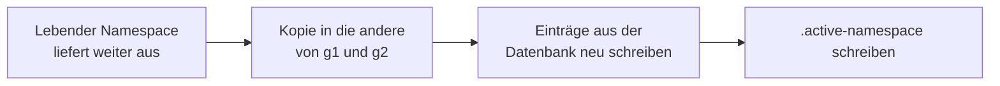

# Gemeinsamer Cache-Aufbau

`zmsbackend` und `zmscitizenapi` teilen sich einen Dateisystem-Cache: PSR-16 über Symfonys `FilesystemAdapter`, Verzeichnis `CACHE_DIR`, Standardlaufzeit `SOURCE_CACHE_TTL` (3600 Sekunden). Der stündliche Cron baut diesen Cache nach dem DLDB-Import neu. Anfragen lesen weiter die Kopie, die bereits ausliefert, bis die neue Kopie fertig ist. Der Wechsel ist eine Zeigerdatei, kein Leeren.

## Verzeichnisaufbau

| Pfad                                | Rolle                                                                                         |
| ----------------------------------- | --------------------------------------------------------------------------------------------- |
| `CACHE_DIR/@/`                      | Leerer Namespace. Wird genutzt, wenn `.active-namespace` fehlt oder nicht `g1` oder `g2` ist. |
| `CACHE_DIR/g1/` und `CACHE_DIR/g2/` | Die zwei Generationen. Jeder Lauf verwendet eine davon als Bereitschaftskopie.                |
| `CACHE_DIR/.active-namespace`       | `g1` oder `g2`. Neue Anfragen lesen das in `CacheBootstrap::create()`.                        |
| `CACHE_DIR/.staging.lock`           | Exklusive Sperre, solange eine Bereitschaftskopie gebaut wird.                                |

Symfony legt einen leeren Namespace als `@` ab. Nach dem ersten Aufbau bleibt `@` auf der Platte. Es wird erst wieder genutzt, wenn der Zeiger fehlt oder ungültig ist. Es wird im normalen Betrieb nicht gelöscht.

Lokal steht `CACHE_DIR` in `.devcontainer/.env` auf `/var/www/html/cache`. Das Repo ist dorthin eingehängt, der Ordner im Arbeitsverzeichnis ist also `cache/`.

## Wie ein Lauf umschaltet



1. `CacheBootstrap::openStaging()` nimmt die Sperre, wählt die Generation, die nicht lebt (`''` oder `g2` wird `g1`, `g1` wird `g2`), löscht dieses Verzeichnis und kopiert den lebenden Namespace hinein.
2. Der Aufbau zeigt `App::$cache` auf die Bereitschaftskopie und schreibt die Einträge dort neu. `LoggerService::$cache` bleibt auf dem Namespace, der beim Prozessstart geöffnet wurde. Zähler der Log-Ratenbegrenzung werden nicht umgehängt. Zähler, die schon in den kopierten Dateien lagen, kommen mit, wenn die Kopie veröffentlicht wird.
3. `publishNamespace()` schreibt `.active-namespace` über eine temporäre Datei und `rename`. Der Wechsel wird verweigert, wenn sich der lebende Namespace während des Kopierens geändert hat. Danach wird die Sperre freigegeben.
4. Eine Anfrage, die schon einen Adapter hat, behält ihn. Die nächste Anfrage liest den Zeiger und öffnet die veröffentlichte Generation.
5. Ein fehlgeschlagener Aufbau ruft `abortStaging()` auf, veröffentlicht nicht und lässt die vorherige Generation liegen.

Wenn der Backend-Aufbau gelingt, veröffentlicht der erste Stundenlauf `g1` aus dem Backend. Wenn er fehlschlägt, veröffentlicht das Backend nichts, und der Citizen-Aufbau läuft trotzdem. `g2` wird nur veröffentlicht, wenn `ZMS_CITIZENAPI_WARMUP_URL` gesetzt ist und dieser POST gelingt. Spätere Läufe tauschen die Generation, die gerade lebt.

## Reihenfolge

`zmsbackend/cron/cronjob.hourly` ruft nach dem DLDB-Import `bin/warmupCitizenapiSourceCache --commit` auf.

1. Das Backend baut den gemeinsamen API-Cache in die Bereitschaftskopie und veröffentlicht sie.
2. Dasselbe Skript sendet den Citizen-Aufbau per POST. Die URL ist `ZMS_CITIZENAPI_WARMUP_URL`. Der Header `X-Source-Cache-Warmup-Token` wird gesendet, wenn `SOURCE_CACHE_WARMUP_TOKEN` gesetzt ist. Eine leere URL überspringt den Aufruf. Das Curl-Timeout ist 180 Sekunden. Ein fehlgeschlagener Citizen-Aufruf wird geloggt. Das Skript endet mit Status 0, außer der gemeinsame Cache-Aufbau ist fehlgeschlagen.
3. `POST /source-cache/warmup/` öffnet die andere Generation, kopiert den Cache, den das Backend gerade veröffentlicht hat, frischt die Citizen-Schlüssel auf und veröffentlicht. Dieser POST ist eine neue PHP-Anfrage und liest deshalb den veröffentlichten Backend-Cache. Citizen-Schlüssel, die die Slot-Länge aus `/source/{name}/` übernehmen, sehen damit den neuen Wert.

`GET /offices-and-services/` bleibt Cache-Aside: ein Treffer wird so ausgeliefert, wie er liegt, ein Fehltreffer baut diese Antwort weiterhin neu.

## Was neu gebaut wird

Backend-Einträge werden auf den Resolve-Stufen 0, 1 und 2 geschrieben. Der Lesezugriff umgeht den Cache, damit eine kopierte Datei aus der Datenbank ersetzt wird:

- Konfiguration, gemeinsame Feiertage und jede Quelle
- Listen von Providern, Requests, Departments, Clustern und Scopes, danach eine Id nach der anderen
- die Benutzerkontenliste, jede Rollenliste, die leere Benutzersuche und ein Cache-Eintrag je Konto

Eine getippte Benutzersuche oder eine Benutzerliste, die nach einer im Request gewählten Dienststellenmenge gefiltert ist, wird nicht gecacht. Der Aufbau kann diese Filter nicht kennen.

Citizen-Einträge, nach der Backend-Veröffentlichung:

- Quelldaten, Scopes, Standorte und Dienstleistungen, einschließlich der unveröffentlichten Varianten
- die Nutzdaten von Standorten und Dienstleistungen
- Dienstleistungen und zusammengeführte Mailvorlagen je Standort

Ein Datenbankschreiben, das ankommt, nachdem sein Schlüssel neu geschrieben wurde, bleibt einen Lauf zurück. Das ist dieselbe Grenze wie beim stündlichen Aufbau. Für einen Schlüssel, den der Aufbau neu schreibt, wird nicht die kopierte Datei veröffentlicht.

## Worker

`ZMS_CACHE_WARMUP_WORKERS` setzt die Worker-Zahl. Der Standard ist 4. Ein Wert von 0 oder weniger wird zu 1. Ein einzelner Job oder eine Zahl von 1 bleibt im Elternprozess.

Der Backend-Elternprozess schreibt zuerst die gemeinsamen Listen. Danach teilt er die Arbeit je Id in zwei Phasen: Provider, Requests, Departments, Cluster und Scopes, danach Benutzerkonten. Konten-Jobs starten nach den Katalog-Jobs, damit ein Department-Scope-Schlüssel schon existiert. Worker öffnen den Bereitschafts-Namespace, der schon da ist. Sie öffnen keine neue Staging-Kopie und veröffentlichen nicht. Ein Worker mit Exit ungleich 0 wird im Elternprozess neu gebaut.

Citizen-Standorte werden genauso aufgeteilt. PHPUnit behält diese Schleife im Testprozess.

Die Worker-Binary ist `PHP_BINARY`, außer diese Binary ist php-fpm oder httpd. Dann ist es `php`.

## Sperre

`openStaging()` hält ein exklusives `flock` auf `CACHE_DIR/.staging.lock` vom Kopieren bis zur Veröffentlichung oder zum Abbruch. Das Backend gibt sie in `publishNamespace()` frei, bevor der Citizen-POST kommt, damit der Citizen-Aufbau dieselbe Sperre nehmen kann. Worker nehmen sie nicht. Eine Sperre freizugeben, die schon weg ist, tut nichts.

## Lokale Befehle

```bash
podman exec -it zms-web bash -lc "cd zmsbackend && ./cron/cronjob.hourly --city=munich"
podman exec -it zms-web bash -lc "cd zmsbackend && bin/warmupCitizenapiSourceCache --commit"
podman exec -it zms-web bash -lc "./cli modules clear-local-cache"
```

`clear-local-cache` entfernt den Inhalt des Cache-Verzeichnisses. Die nächste Anfrage nutzt `@`, bis ein Aufbau die Backend-Generation veröffentlicht. Die zweite Generation wird nur veröffentlicht, wenn der Citizen-Aufbau gelingt.
