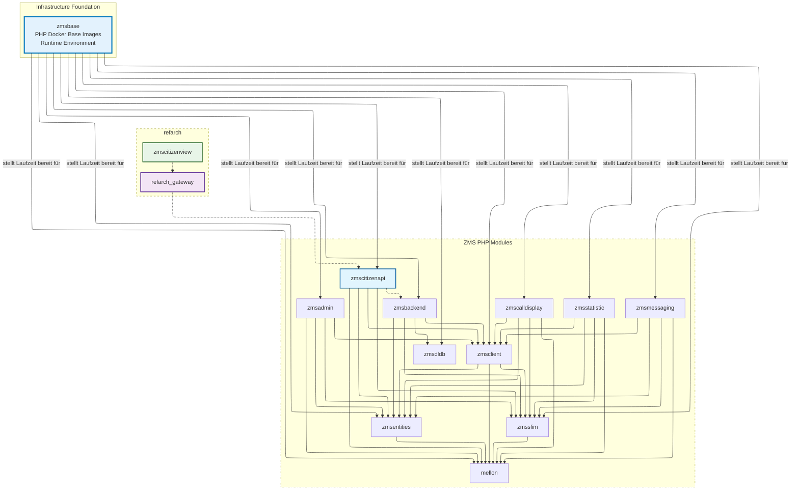

# E-Appointment PHP-Basis-Images (`zmsbase`)

Infrastrukturgrundlage: Das Verzeichnis [`zmsbase`](https://github.com/it-at-m/eappointment/tree/main/zmsbase) in diesem Monorepo stellt standardisierte, vorgebaute PHP-Laufzeit-Images für eappointment-[Modul-Builds](https://github.com/it-at-m/eappointment/blob/main/.github/workflows/php-build-images.yaml) über das [Containerfile](https://github.com/it-at-m/eappointment/blob/main/.resources/Containerfile) bereit.

- Quellcode: [`zmsbase/`](https://github.com/it-at-m/eappointment/tree/main/zmsbase) in [it-at-m/eappointment](https://github.com/it-at-m/eappointment)
- Früheres Standalone-Repository: [it-at-m/eappointment-php-base](https://github.com/it-at-m/eappointment-php-base) (ersetzt durch `zmsbase`)
- Ursprüngliches Berliner Repository: [gitlab.com/eappointment/php-base](https://gitlab.com/eappointment/php-base)

## Image-Varianten und Verwendung

Basierend auf [`.github/workflows/zmsbase-build-images.yaml`](https://github.com/it-at-m/eappointment/blob/main/.github/workflows/zmsbase-build-images.yaml) veröffentlicht das Projekt diese Images:

- `8.4-base` und `8.4-dev` aus `zmsbase/php84/Dockerfile`
- `8.4-local-amd64` und `8.4-local-arm64` aus `zmsbase/php84-local/Dockerfile`
- `8.6-base` und `8.6-dev` aus `zmsbase/php86/Dockerfile` (PHP 8.6.0, veröffentlicht am 19. November 2026)
- `8.6-local-amd64` und `8.6-local-arm64` aus `zmsbase/php86-local/Dockerfile`

Die Rollenaufteilung:

- Lokale Images (`8.4-local-*`) sind für lokale Entwicklung und `zmsautomation` gedacht. Devcontainer nutzt standardmäßig `8.4-local-*` über `ZMS_PHP_BASE_TAG`. `8.6-local-*` steht zum Ausprobieren von PHP 8.6 bereit.
- Nicht-lokale Images (`8.4-base`, `8.4-dev`) sind für produktionsnahe/laufzeitorientierte Umgebungen gedacht. Modul-Images und CI nutzen `8.4-base` und `8.4-dev`. `8.6-base` und `8.6-dev` werden parallel gebaut und sind noch nicht in die Modul-Images eingebunden.

Diese duale lokale Architektur unterstützt die Entwicklung auf macOS Apple Silicon und anderen Nicht-amd64-Umgebungen und bietet zugleich linux/amd64-Kompatibilität.

## Lokale Architekturunterstützung

Die Jobs `php_v8_4_local` und `php_v8_6_local` bauen Single-Architecture-Tags in einer Matrix:

- `linux/amd64` auf `ubuntu-latest` → `8.4-local-amd64` und `8.6-local-amd64`
- `linux/arm64` auf `ubuntu-24.04-arm` → `8.4-local-arm64` und `8.6-local-arm64`

Devcontainer setzt `ZMS_PHP_BASE_TAG` und zieht dieses Image über [`.devcontainer/scripts/sync-php-base-tag.sh`](https://github.com/it-at-m/eappointment/blob/main/.devcontainer/scripts/sync-php-base-tag.sh), bevor Compose startet.

## Verhalten des Build- und Veröffentlichungs-Workflows

Workflow: [🐳 Build ZMS base images](https://github.com/it-at-m/eappointment/blob/main/.github/workflows/zmsbase-build-images.yaml) (`zmsbase-build-images.yaml`).

Er läuft bei:

- wöchentlichem Zeitplan auf `main` (Montags `0 3 * * 1` UTC ≈ 05:00 Europe/Berlin im Sommer; geplante Workflows laufen nur auf dem Default-Branch)
- manuellem `workflow_dispatch` auf jedem Branch (nach Änderungen an `zmsbase/` auf einem Feature-Branch, bevor CI neue Images braucht). Die Eingabe `php_version` baut `all`, `8.4` oder `8.6`; der Wochenplan baut immer alle Linien.

Jeder Image-Job meldet sich bei GHCR an, baut die Image-Targets, validiert den PHP-Start (`php-fpm -t` oder `php -v`) und pusht die resultierenden Tags nach:

- `ghcr.io/it-at-m/eappointment/zmsbase`

Dieser GHCR-Publish ist die öffentliche Hälfte des [CI/CD-Ablaufs](../operations/ci-cd.md) (Quay-Spiegel, GitLab-Helm, OpenShift).

## Modul-Abhängigkeitskontext

