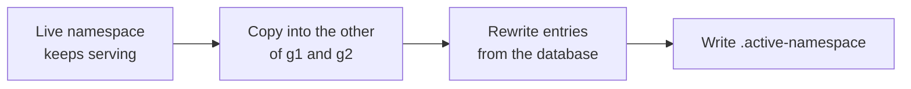

# Shared cache warmup

`zmsbackend` and `zmscitizenapi` share one filesystem cache: PSR-16 on Symfony's `FilesystemAdapter`, directory `CACHE_DIR`, default lifetime `SOURCE_CACHE_TTL` (3600 seconds). The hourly cron rebuilds that cache after the DLDB import. Requests keep reading the copy that is already serving until the new copy is complete. The switch is a pointer file, not a clear.

## Directory layout

| Path                                | Role                                                                           |
| ----------------------------------- | ------------------------------------------------------------------------------ |
| `CACHE_DIR/@/`                      | Empty namespace. Used when `.active-namespace` is missing or not `g1` or `g2`. |
| `CACHE_DIR/g1/` and `CACHE_DIR/g2/` | The two generations. Each run reuses one of them as the standby copy.          |
| `CACHE_DIR/.active-namespace`       | `g1` or `g2`. New requests read this in `CacheBootstrap::create()`.            |
| `CACHE_DIR/.staging.lock`           | Exclusive lock held while a standby copy is built.                             |

Symfony stores an empty namespace as `@`. After the first warmup, `@` stays on disk. It is used again only when the pointer is missing or invalid. Do not delete it as part of a normal run.

Locally, `CACHE_DIR` in `.devcontainer/.env` is `/var/www/html/cache`, and the repo is bind-mounted there, so the folder is `cache/` in the working tree.

## How a run switches



1. `CacheBootstrap::openStaging()` takes the lock, picks the generation that is not live (`''` or `g2` goes to `g1`, `g1` goes to `g2`), deletes that directory, and copies the live namespace into it.
2. The rebuild points `App::$cache` at the standby and rewrites entries there. `LoggerService::$cache` stays on the live namespace opened at process start, so log rate-limit counters are not retargeted. Counters that were already in the copied files come along when the copy is published.
3. `publishNamespace()` writes `.active-namespace` through a temporary file and `rename`. It refuses the switch if the live namespace changed while the copy was built, then releases the lock.
4. A request that already has an adapter keeps it. The next request reads the pointer and opens the published generation.
5. A failed rebuild calls `abortStaging()`, does not publish, and leaves the previous generation in place.

If the backend rebuild succeeds, the first hourly run publishes `g1` from the backend. If it fails, the backend publishes nothing, and the citizen warmup still runs. `g2` is published only when `ZMS_CITIZENAPI_WARMUP_URL` is set and that POST succeeds. Later runs swap the generation that is live.

## Order

`zmsbackend/cron/cronjob.hourly` calls `bin/warmupCitizenapiSourceCache --commit` after the DLDB import.

1. The backend rebuilds the shared API cache into the standby and publishes it.
2. The same script POSTs the citizen warmup. The URL is `ZMS_CITIZENAPI_WARMUP_URL`. The header `X-Source-Cache-Warmup-Token` is sent when `SOURCE_CACHE_WARMUP_TOKEN` is set. An empty URL skips the call. The curl timeout is 180 seconds. A failed citizen call is logged. The script exits with status 0 unless the shared-cache rebuild failed.
3. `POST /source-cache/warmup/` opens the other generation, copies the cache the backend just published, refreshes the citizen keys, and publishes. That POST is a new PHP request, so it reads the published backend cache. Citizen keys that copy slot length from `/source/{name}/` therefore see the new value.

`GET /offices-and-services/` stays cache-aside: a hit is served as stored, and a miss still rebuilds that response.

## What is rebuilt

Backend entries are written at resolve levels 0, 1, and 2, with the cache bypassed on the read so a copied file is replaced from the database:

- config, common days off, and each source
- provider, request, department, cluster, and scope lists, then one id at a time
- the user-account list, each role list, the empty user search, and one cache entry per account

A typed user search, or a user list filtered by a department set chosen on the request, is not cached. The warmup cannot know those filters.

Citizen entries, after the backend publish:

- source payloads, scopes, offices, and services, including the unpublished variants
- the offices-and-services payload
- services and merged mail templates for each office

A database write that arrives after its key was rewritten stays one run behind. That is the same bound as the hourly rebuild. The copied file is not what gets published for a key the warmup rewrites.

## Workers

`ZMS_CACHE_WARMUP_WORKERS` sets the worker count. The default is 4. A value of 0 or less becomes 1. A single job, or a count of 1, stays in the parent process.

The backend parent writes the shared lists first. It then splits per-id work into two phases: providers, requests, departments, clusters, and scopes, then user accounts. Account jobs start after the catalog jobs so a department scope key already exists. Workers open the standby namespace that already exists. They do not open a new staging copy and they do not publish. A worker that exits non-zero is rebuilt in the parent.

Citizen offices are split the same way. PHPUnit keeps that loop in the test process.

The worker binary is `PHP_BINARY`, unless that binary is php-fpm or httpd, in which case it is `php`.

## Lock

`openStaging()` holds an exclusive `flock` on `CACHE_DIR/.staging.lock` from the copy until publish or abort. The backend releases it in `publishNamespace()` before the citizen POST, so the citizen warmup can take the same lock. Workers do not take it. Releasing a lock that is already gone does nothing.

## Local commands

```bash
podman exec -it zms-web bash -lc "cd zmsbackend && ./cron/cronjob.hourly --city=munich"
podman exec -it zms-web bash -lc "cd zmsbackend && bin/warmupCitizenapiSourceCache --commit"
podman exec -it zms-web bash -lc "./cli modules clear-local-cache"
```

`clear-local-cache` removes the cache directory contents. The next request uses `@` until a warmup run publishes the backend generation. The second generation is published only when the citizen warmup succeeds.
